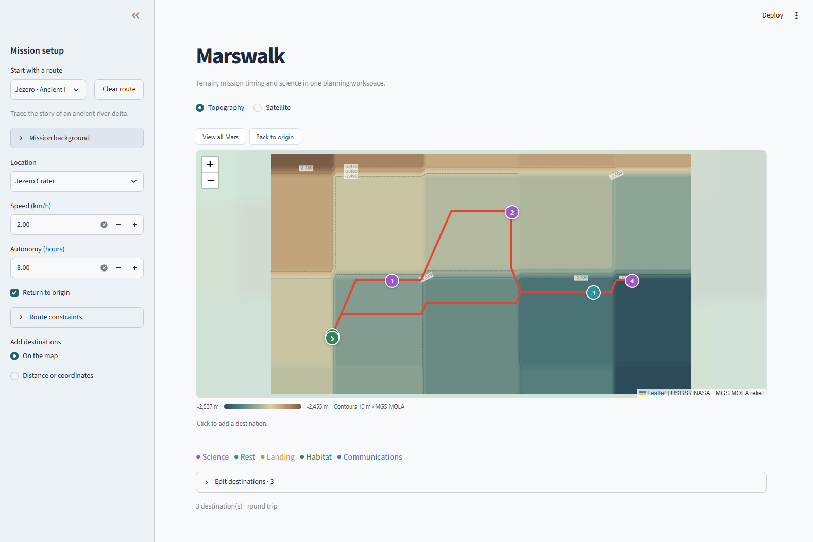

# Marswalk

**Explore the terrain. Plan the traverse. Put the science in context.**

[](https://www.python.org/)
[](https://streamlit.io/)
[](#data-sources)


Marswalk is an interactive Mars exploration planner that connects a proposed
surface route with the terrain, scientific objectives and observations needed
to understand it. Mark destinations on the map, schedule activities, and see
how walking speed, rest stops and autonomy affect the complete mission.

[Quick start](#quick-start) · [Prepared missions](#five-prepared-missions) · [Data sources](#data-sources) · [Deploy from GitHub](#deploy-from-github)



*Jezero demonstration using NASA MOLA terrain. The route and observation
stations are planning proposals, not a verified rover track.*

## What you can do

| Capability | In the app |
| --- | --- |
| **Read the terrain** | Switch between topography and satellite imagery. Inspect elevation colours, labelled contours and the route profile. |
| **Build a mission** | Place destinations on the map or enter coordinates. Assign science, rest, landing, habitat or communications activities. |
| **Plan the time budget** | Set speed, autonomy and reserve. Rest stops and arrival times update automatically, including the return leg when enabled. |
| **Understand each point** | Read its activity, on-site duration, elevation and available geological context. See how far the routing grid moved a requested target. |
| **Connect observations to the route** | View infrared imagery under the path, query geology at numbered stops, and inspect relevant historical weather and radiation data. |
| **Take the plan with you** | Export the route, activities, rest stops and resource provenance as GeoJSON. Download the route-area THEMIS mosaic separately. |

There is no fixed exploration radius. The download area follows your points,
and the input fields have no arbitrary numeric caps. Values are validated
when needed for geographical and mathematical correctness.

## Quick start

Use **Python 3.12** for the tested setup. Download or clone this repository,
then open a terminal in its root directory.

<details open>
<summary><strong>Windows · PowerShell</strong></summary>

```powershell
python -m venv .venv
.\.venv\Scripts\Activate.ps1
python -m pip install -r requirements.txt
python -m streamlit run example.py
```

If PowerShell blocks activation, use the environment's interpreter directly:

```powershell
.\.venv\Scripts\python.exe -m pip install -r requirements.txt
.\.venv\Scripts\python.exe -m streamlit run example.py
```

</details>

<details>
<summary><strong>macOS / Linux</strong></summary>

```bash
python3 -m venv .venv
source .venv/bin/activate
python -m pip install -r requirements.txt
python -m streamlit run example.py
```

</details>

Open the local URL printed by Streamlit, normally **http://localhost:8501**.
An internet connection is required for the basemaps and external data services.
No NASA API key is required for the currently connected sources.

For the existing Windows setup, `run.ps1` also starts the app. It uses a local
`.runtime` interpreter when present, otherwise the active `python` command.

## Plan your first Marswalk

1. **Choose a mission** from the sidebar, or select **Custom route**.
2. **Set the origin and destinations.** Click the map, select a zone type,
   describe the activity, and add the point. Coordinate entry is also available.
3. **Adjust the mission budget.** Set walking speed, total autonomy and
   whether to return to the origin. Additional constraints are folded away.
4. **Review the route.** Switch map views, inspect numbered points, compare
   the elevation profile and explore the resources linked to the itinerary.
5. **Export or start again.** Download the plan from **Export**, or use
   **Clear route** to remove the draft, calculated path, selected point and
   imported data while retaining the origin and numerical settings.

## Five prepared missions

Each preset loads three editable science destinations, an origin and initial
planning settings. The terrain route and rest stops are calculated on selection.

| Mission | Exploration focus | Science background |
| --- | --- | --- |
| **Jezero · Ancient Delta** | Delta context panoramas and surface-texture comparisons. | [NASA: Jezero delta](https://science.nasa.gov/resource/perseverance-explores-the-jezero-crater-delta/) |
| **Gale · Layers of Time** | Crater-floor observations and the regional context of Mount Sharp. | [NASA: Mount Sharp](https://science.nasa.gov/resource/the-making-of-mount-sharp/) |
| **Columbia Hills · Water Clues** | Hillside relief and surface contrasts in the region explored by Spirit. | [NASA: Spirit](https://science.nasa.gov/mission/mer-spirit/) |
| **Victoria · Crater Stories** | The impact landscape and proposed crater-region viewpoints. | [NASA: Victoria Crater](https://science.nasa.gov/photojournal/victoria-crater-at-meridiani-planum/) |
| **Ares Vallis · Floodplain Explorer** | Rock-shape comparisons and the Pathfinder-region floodplain. | [NASA: Mars Pathfinder](https://science.nasa.gov/mission/mars-pathfinder/) |

The station names describe **planned observation tasks**. They do not assert
that a specific feature, safe landing site or accessible viewpoint has been
verified at the selected coordinates.

## How the planning works

Marswalk downloads an elevation grid covering the selected points and uses
**Dijkstra's algorithm with eight-neighbour connectivity** to find routes
through the destinations in their listed order. A sampled-slope constraint
filters grid connections. The app does not optimise the order of visits.

Rest stops are inserted along the resulting path using the configured walking
speed and time budget. A sufficiently long manual rest resets the walking
counter. Activities and pauses both count toward the complete mission time.

<details>
<summary><strong>Time-budget assumptions</strong></summary>

```text
usable_hours = autonomy_hours × (1 − reserve_percent / 100)
walking_hours = route_distance_km / speed_kmh
total_hours = walking_hours + activity_hours + rest_hours
```

The walking interval is the smaller of the continuous-walking setting and
one quarter of usable autonomy. Default settings are a 60-minute maximum
walking interval and 10 minutes per rest.

This is an adjustable planning rule, not a physiological model. Resting does
not replenish autonomy. A route that exceeds the remaining budget is flagged
rather than presented as a feasible mission.

</details>

## Data sources

| Source | What Marswalk uses | How it relates to the route |
| --- | --- | --- |
| [NASA Mars Trek / MGS MOLA](https://trek.nasa.gov/mars/) | Elevation samples and global relief imagery. | Path calculation, topographic colours, contours and elevation profiles. |
| [NASA Mars Trek / Viking MDIM 2.1](https://trek.nasa.gov/mars/) | Visible orbital mosaic. | Satellite basemap beneath the itinerary. |
| [Mars Odyssey THEMIS / USGS](https://planetarymaps.usgs.gov/) | Historical daytime infrared mosaic. | Georeferenced image covering the route area, with the path and stops overlaid. |
| [USGS geologic map of Mars](https://pubs.usgs.gov/sim/3292/) | Tanaka et al. (2014), scale 1:20 million. | Geological units queried at the origin and numbered itinerary points. |
| [NASA Image and Video Library](https://images.nasa.gov/) | Regional photographs and their metadata. | Context for the origin region; positions on individual stops are not verified. |
| [Curiosity REMS](https://science.nasa.gov/mission/msl-curiosity/science-instruments/) / [Perseverance MEDA](https://science.nasa.gov/mission/mars-2020-perseverance/science-instruments/) | Dated weather reports and UV categories where published. | Historical regional references for Gale and Jezero respectively. |
| [Curiosity RAD / NASA SPDF](https://spdf.gsfc.nasa.gov/pub/data/aaa_planetary/msl/rad/cdf/obs-l2/) | Quality-filtered detector-E absorbed-dose rates. | Historical radiation context for regionally associated Gale itineraries. |

Resources are cached for one hour. Provider failures are reported without
discarding a successfully calculated route. Source links and measurement
dates are preserved in the exported plan.

### Weather and radiation, with context

The **Weather & radiation** view displays the observation date, source,
available readings and associated route-point IDs. Missing values stay missing;
weather readings from different sols are not combined into a single report.

RAD processing excludes flagged, fill and out-of-range values. An optional
comparison holds the historical detector-E median constant over the full
route duration, including rests. It reports **absorbed detector dose in µGy**,
not human effective dose or dose inside a spacesuit.

These observations are **historical context, not a current forecast**. Their
regional association does not establish conditions at each stop, and they do
not change the pathfinding or rest rules. UV categories and ionizing-radiation
measurements are displayed separately.

### Add your own layer

Upload a UTF-8 CSV under **Import a layer**, with longitude in degrees east:

```csv
lon,lat,value
77.395,18.455,1.2
77.405,18.460,1.5
```

Declare the product source, variable and units. Samples inside the mission area
are shown alongside the route; they do not affect pathfinding. The example
above only illustrates the file format and is not a scientific dataset.

## Deploy from GitHub

The app can be deployed using [Streamlit Community Cloud](https://share.streamlit.io/):

1. Push the project to a GitHub repository, including `example.py`,
   `requirements.txt`, `mars_help/` and `.streamlit/`.
2. Sign in to Community Cloud with GitHub and create an app.
3. Select the repository, your branch and **`example.py`** as the entrypoint.
4. Deploy, then add the generated public URL to the repository's
   **About → Website** field and to this README.

See the [official deployment guide](https://docs.streamlit.io/deploy/streamlit-community-cloud/deploy-your-app/deploy).
The local `.runtime/` and `.venv/` directories are excluded by `.gitignore`
and should not be uploaded. GitHub Pages can host a project landing page,
but [cannot execute this Python backend](https://docs.github.com/en/pages/getting-started-with-github-pages/creating-a-github-pages-site).

<!-- Once deployed, add an Open Marswalk link near the top using the real public URL. -->

## Project structure

```text
example.py                    Streamlit entrypoint
mars_help/
  marswalk.py                 Mission workspace and application state
  terrain_routes.py          Terrain routing and distance calculations
  mission_planning.py        Route bounds, timing and rest scheduling
  topography.py              Elevation shading and contour rendering
  point_details.py           Activity descriptions and grid adjustments
  presets.py                 Five editable mission templates
  mission_resources.py       Route-linked imagery and geological queries
  environment.py             Weather and radiation retrieval and validation
  route_views.py             Itinerary inspection and resource views
  environment_views.py       Historical environmental context
  mars_elevation.py          NASA Mars Trek elevation helper
  map_picker/                Interactive Leaflet map component
tests/                       Unit and Streamlit application tests
docs/images/                 README screenshots
.streamlit/config.toml        Application theme
requirements.txt             Python dependencies
run.ps1                      Windows launcher
```

### Development checks

With the project environment active:

```bash
python -m unittest discover -s tests -v
```

The tests cover routing behaviour, rest timing, preset loading, route clearing,
point inspection, topographic orientation and environmental-data handling.
External providers are mocked in the automated UI tests.

## Scope and limitations

**Marswalk is an educational planning prototype, not a certified navigation
or astronaut-safety system.**

- MOLA sampling cannot resolve small rocks, fissures or sand hazards.
  Rendered contours do not add ground detail to the underlying measurements.
- Targets snap to grid cells; the inspector reports the resulting displacement.
  A grid-feasible route does not establish real-world walkability.
- Landing, habitat and rest zones are proposed waypoints, not validated sites.
- THEMIS is a historical infrared mosaic, not a live temperature map. The
  geological map provides regional context rather than local hazard detection.
- The budget does not model oxygen consumption, suit performance or fatigue.
  Environmental observations do not certify safe conditions.
- Routes crossing the antimeridian are not currently supported.

## Acknowledgements

Marswalk uses public data services from NASA, JPL, USGS and the contributing
mission teams. RAD data are credited to D. Hassler / SwRI and distributed
through NASA SPDF / CDAWeb. Weather reports are outreach products supplied
through the NASA Mars feeds; consult their provider guidance for scientific use.

This is an independent project. Use of these data does not imply NASA or USGS
endorsement. Consult each provider's terms and attribution requirements when
redistributing its products.
