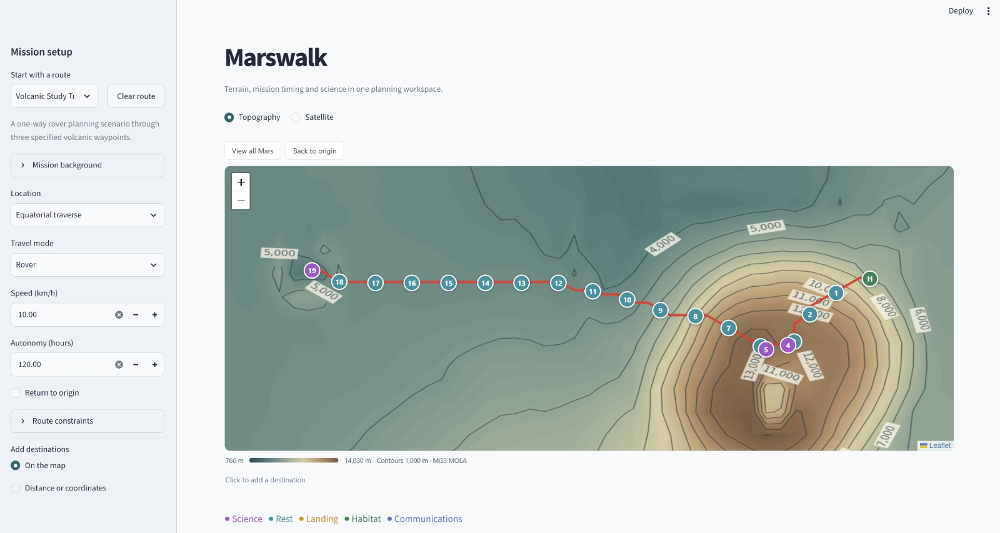

# Marswalk

**Explore the terrain. Plan the traverse. Put the science in context.**

### [Open Marswalk](https://hackathon-g2xf29y2duz3mnk9yvtvwj.streamlit.app/)
[](https://www.python.org/)
[](https://streamlit.io/)
[](#data-sources)


Marswalk is an interactive Mars exploration planner that connects a proposed
surface route with the terrain, scientific objectives and observations needed
to understand it. Mark destinations on the map, schedule activities, and see
how travel speed, rest stops and autonomy affect the complete mission.

[Quick start](#quick-start) · [Prepared mission](#prepared-mission) · [Data sources](#data-sources)



*Equatorial Westbound Traverse using NASA MOLA terrain. This is a multi-day
rover planning scenario, not a verified or safety-certified traverse.*

## What you can do

| Capability | In the app |
| --- | --- |
| **Read the terrain** | Topography shows elevation colours and contours across the visible map, updating when you pan or zoom. Satellite imagery is available as a separate view. |
| **Build a mission** | Place destinations on the map or enter coordinates. Assign science, rest, landing, habitat or communications activities. |
| **Plan the time budget** | Set speed, autonomy and reserve. Rest stops and arrival times update automatically, including the return leg when enabled. |
| **Understand each point** | Read its activity, on-site duration, elevation and available geological context. See how far the routing grid moved a requested target. |
| **Connect observations to the route** | View infrared imagery under the path, query geology at numbered stops, and inspect relevant historical weather and radiation data. |
| **Take the plan with you** | Export the route, activities, rest stops and resource provenance as GeoJSON. Download the route-area THEMIS mosaic separately. |

## Quick start

Use **Python 3.12** for the tested setup. Download or clone this repository,
then open a terminal in its root directory.

<details open>
<summary><strong>Windows · PowerShell</strong></summary>

```powershell
python -m venv .venv
.\.venv\Scripts\Activate.ps1
python -m pip install -r requirements.txt
python -m streamlit run app.py
```

If PowerShell blocks activation, use the environment's interpreter directly:

```powershell
.\.venv\Scripts\python.exe -m pip install -r requirements.txt
.\.venv\Scripts\python.exe -m streamlit run app.py
```

</details>

<details>
<summary><strong>macOS / Linux</strong></summary>

```bash
python3 -m venv .venv
source .venv/bin/activate
python -m pip install -r requirements.txt
python -m streamlit run app.py
```

</details>

Open the local URL printed by Streamlit, normally **http://localhost:8501**.
An internet connection is required for the basemaps and external data services.
No NASA API key is required for the currently connected sources.

## Plan your first Marswalk

1. **Use the prepared mission**, loaded on startup, or select **Custom route**.
2. **Set the origin and destinations.** Click the map, select a zone type,
   describe the activity, and add the point. Coordinate entry is also available.
3. **Adjust the mission budget.** Set travel speed, total autonomy and
   whether to return to the origin. Additional constraints are folded away.
4. **Review the route.** Switch map views, inspect numbered points, compare
   the elevation profile and explore the resources linked to the itinerary.
5. **Export or start again.** Download the plan from **Export**, or use
   **Clear route** to remove the draft, calculated path, selected point and
   imported data while retaining the origin and numerical settings.

## Prepared mission

**Volcanic Study Traverse** is the only prepared mission. Coordinates
are supplied as **latitude, longitude**, and are visited in this order:

| Point | Latitude | Longitude | Role |
| --- | --- | --- | --- |
| Origin | 2.78758 | -111.07354 | Departure |
| 1 | 1.57 | -112.58 | Tharsis Montes |
| 2 | 1.48 | -112.96 | Pavonis Mons |

The initial configuration is a **one-way rover scenario**: 10 km/h travel,
120 hours of autonomy, 5% reserve, a 30-minute stop after every 240 minutes
of driving, and 30 minutes of activity at each destination. Return to origin
is disabled by default. All values remain editable.

The app does not validate vehicle performance, battery/fuel capacity, crew sleep or
life support. The station names describe proposed observation tasks, not
verified features or safe sites at those coordinates.

## Data sources
The prepared route is outside the connected Gale and Jezero environmental
reference regions, so it is not assigned their weather or radiation values.
Those sources remain available for custom routes in the supported regions.

| Source | What Marswalk uses | How it relates to the route |
| --- | --- | --- |
| [NASA Mars Trek / MGS MOLA](https://trek.nasa.gov/mars/) | Elevation samples. | Path calculation, topographic colours, contours and elevation profiles. |
| [NASA Mars Trek / Viking MDIM 2.1](https://trek.nasa.gov/mars/) | Visible orbital mosaic. | Satellite basemap beneath the itinerary. |
| [Mars Odyssey THEMIS / USGS](https://planetarymaps.usgs.gov/) | Historical daytime infrared mosaic. | Georeferenced image covering the route area, with the path and stops overlaid. |
| [USGS geologic map of Mars](https://pubs.usgs.gov/sim/3292/) | Tanaka et al. (2014), scale 1:20 million. | Geological units queried at the origin and numbered itinerary points. |
| [NASA Image and Video Library](https://images.nasa.gov/) | Regional photographs and their metadata. | Context for the origin region; positions on individual stops are not verified. |
| [Curiosity REMS](https://science.nasa.gov/mission/msl-curiosity/science-instruments/) / [Perseverance MEDA](https://science.nasa.gov/mission/mars-2020-perseverance/science-instruments/) | Dated weather reports and UV categories where published. | Historical regional references for Gale and Jezero respectively. |
| [Curiosity RAD / NASA SPDF](https://spdf.gsfc.nasa.gov/pub/data/aaa_planetary/msl/rad/cdf/obs-l2/) | Quality-filtered detector-E absorbed-dose rates. | Historical radiation context for regionally associated Gale itineraries. |

Resources are cached for one hour. Provider failures are reported without
discarding a successfully calculated route. Source links and measurement
dates are preserved in the exported plan.

### Weather and radiation, with context

The **Weather & radiation** view displays the observation date, source,
available readings and associated route-point IDs. Missing values stay missing;
weather readings from different sols are not combined into a single report.

RAD processing excludes flagged, fill and out-of-range values. An optional
comparison holds the historical detector-E median constant over the full
route duration, including rests. It reports **absorbed detector dose in µGy**,
not human effective dose or dose inside a spacesuit.

These observations are **historical context, not a current forecast**. Their
regional association does not establish conditions at each stop, and they do
not change the pathfinding or rest rules. UV categories and ionizing-radiation
measurements are displayed separately.

### Add your own layer

Upload a UTF-8 CSV under **Import a layer**, with longitude in degrees east:

```csv
lon,lat,value
77.395,18.455,1.2
77.405,18.460,1.5
```

Declare the product source, variable and units. Samples inside the mission area
are shown alongside the route; they do not affect pathfinding. The example
above only illustrates the file format and is not a scientific dataset.

## Scope and limitations

**Marswalk is an educational planning prototype, not a certified navigation
or astronaut-safety system.**

- MOLA sampling cannot resolve small rocks, fissures or sand hazards.
  Rendered contours do not add ground detail to the underlying measurements.
- Targets snap to grid cells; the inspector reports the resulting displacement.
  A grid-feasible route does not establish real-world walkability.
- Landing, habitat and rest zones are proposed waypoints, not validated sites.
- THEMIS is a historical infrared mosaic, not a live temperature map. The
  geological map provides regional context rather than local hazard detection.
- The budget does not model oxygen consumption, suit performance or fatigue.
  Environmental observations do not certify safe conditions.
- Routes crossing the antimeridian are not currently supported.

## Acknowledgements

Marswalk uses public data services from NASA, JPL, USGS and the contributing
mission teams. RAD data are credited to D. Hassler / SwRI and distributed
through NASA SPDF / CDAWeb. Weather reports are outreach products supplied
through the NASA Mars feeds; consult their provider guidance for scientific use.

This is an independent project. Use of these data does not imply NASA or USGS
endorsement. Consult each provider's terms and attribution requirements when
redistributing its products.
